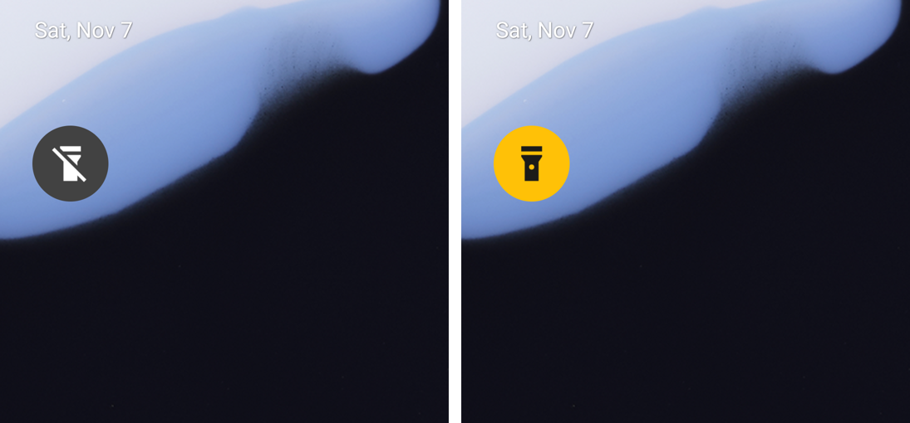

# SeniorLight

A very simple flashlight for Android, made for seniors.

Tap it once: the light goes on. Tap it again: the light goes off. Nothing else
opens, there is nothing to set up and nothing to read.

English and German. The app follows the phone's language.

[Deutsch weiter unten](#seniorlight-deutsch)

## What you see

  

A round button on the home screen, the size of an app icon:

- **Dark grey with a crossed-out flashlight:** the light is off. Tap to turn it on.
- **Yellow with a flashlight:** the light is on. Tap to turn it off.

The button always shows the real state, also when the light was switched in the
phone's quick settings.

The app also has a normal app icon (a flashlight on yellow) in the app list.
Tapping it switches the light too, but that icon always looks the same: Android
does not let an app change its own icon. That is why the round button exists.

## Install

1. Download the latest `SeniorLight-*.apk` from the
   [Releases](https://github.com/philipphueber/SeniorLight/releases) page on the
   phone.
2. Open it. Android asks whether to allow installing from this source; allow it
   once.

Needs Android 8.0 or newer and a phone with a flash.

## Setting it up (for the helper)

Put the round button on the home screen, where it is easy to find:

1. Touch and hold an empty spot on the home screen.
2. Tap **Widgets**.
3. Find **Flashlight** (search for it if the list is long), tap it and tap
   **Add**, or drag it onto the home screen.

That is all. Tap it once to check that the light comes on, and again to turn it
off.

## Good to know

- While the light is on, Android may show a small "Flashlight is on" notification
  with **Turn off**. It keeps the light from going out by itself.
- If the camera is in use (for example during a video call), the light cannot be
  switched. The phone then says so.

## Privacy

The app has no internet access at all (it does not even ask for it), no
account, no tracking and no ads. It never takes pictures: it only switches the
flash.

## Contributing and licence

Building, technical details and how to help: [CONTRIBUTING.md](CONTRIBUTING.md)
and [ARCHITECTURE.md](ARCHITECTURE.md). Licensed under the
[Apache License 2.0](LICENSE).

---

# SeniorLight (Deutsch)

Eine ganz einfache Taschenlampe für Android, gemacht für Senioren.

Einmal tippen: das Licht geht an. Noch einmal tippen: das Licht geht aus. Sonst
öffnet sich nichts, es gibt nichts einzustellen und nichts zu lesen.

Deutsch und Englisch. Die App folgt der Sprache des Telefons.

## Was man sieht

Bild siehe [oben](#what-you-see).

Ein runder Knopf auf dem Startbildschirm, so groß wie ein App-Symbol:

- **Dunkelgrau mit durchgestrichener Taschenlampe:** das Licht ist aus. Tippen
  schaltet es ein.
- **Gelb mit Taschenlampe:** das Licht ist an. Tippen schaltet es aus.

Der Knopf zeigt immer den echten Zustand, auch wenn das Licht in den
Schnelleinstellungen des Telefons geschaltet wurde.

In der App-Liste gibt es außerdem ein normales App-Symbol (Taschenlampe auf
Gelb). Tippen darauf schaltet das Licht ebenfalls, aber dieses Symbol sieht immer
gleich aus: Android erlaubt einer App nicht, ihr eigenes Symbol zu ändern. Darum
gibt es den runden Knopf.

## Installieren

1. Die neueste `SeniorLight-*.apk` auf der Seite
   [Releases](https://github.com/philipphueber/SeniorLight/releases) auf dem
   Telefon herunterladen.
2. Öffnen. Android fragt, ob Installationen aus dieser Quelle erlaubt werden
   sollen; einmal erlauben.

Benötigt Android 8.0 oder neuer und ein Telefon mit Blitz.

## Einrichten (für die helfende Person)

Den runden Knopf gut sichtbar auf den Startbildschirm legen:

1. Eine freie Stelle auf dem Startbildschirm gedrückt halten.
2. **Widgets** antippen.
3. **Taschenlampe** suchen, antippen und **Hinzufügen** antippen oder auf den
   Startbildschirm ziehen.

Das ist alles. Einmal antippen und prüfen, dass das Licht angeht, dann noch
einmal zum Ausschalten.

## Gut zu wissen

- Solange das Licht an ist, zeigt Android eventuell eine kleine Mitteilung
  „Taschenlampe ist an“ mit **Ausschalten**. Sie sorgt dafür, dass das Licht nicht
  von selbst ausgeht.
- Wenn die Kamera benutzt wird (zum Beispiel bei einem Videoanruf), lässt sich das
  Licht nicht schalten. Das Telefon zeigt dann einen Hinweis.

## Datenschutz

Die App hat keinerlei Internetzugang (sie fragt nicht einmal danach), kein
Konto, kein Tracking und keine Werbung. Sie macht nie Fotos, sie schaltet nur den
Blitz.
