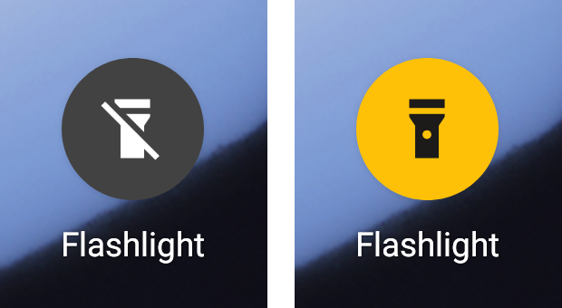

# SeniorLight

A very simple flashlight for Android, made for seniors.

Tap it once: the light goes on. Tap it again: the light goes off. Nothing else
opens, there is nothing to set up and nothing to read.

English and German. The app follows the phone's language.

[Deutsch weiter unten](#seniorlight-deutsch)

## What you see

  

Just the app icon, which shows whether the light is on:

- **Dark grey with a crossed-out flashlight:** the light is off. Tap to turn it on.
- **Yellow with a flashlight:** the light is on. Tap to turn it off.

The icon also follows the light when it is switched in the phone's quick
settings, and shows "off" again after the phone restarts.

## Install

1. Download the latest `SeniorLight-*.apk` from the
   [Releases](https://github.com/philipphueber/SeniorLight/releases) page on the
   phone.
2. Open it. Android asks whether to allow installing from this source; allow it
   once.

Needs Android 8.0 or newer and a phone with a flash.

## Setting it up (for the helper)

Put the **Flashlight** icon on the home screen where it is easy to find: open the
app list, touch and hold **Flashlight** and drag it onto the home screen.

That is all. Tap it once to check that the light comes on and the icon turns
yellow, and again to turn it off.

The icon change was tested with the Pixel home screen on Android 11 and 15.
Other phone makers' home screens may take a moment to redraw it.

## Good to know

- While the light is on, Android may show a small "Flashlight is on" notification
  with **Turn off**. It keeps the light from going out by itself.
- If the camera is in use (for example during a video call), the light cannot be
  switched. The phone then says so.

## Privacy

The app has no internet access at all (it does not even ask for it), no
account, no tracking and no ads. It never takes pictures: it only switches the
flash.

## Contributing and licence

Building, technical details and how to help: [CONTRIBUTING.md](CONTRIBUTING.md)
and [ARCHITECTURE.md](ARCHITECTURE.md). Licensed under the
[Apache License 2.0](LICENSE).

---

# SeniorLight (Deutsch)

Eine ganz einfache Taschenlampe für Android, gemacht für Senioren.

Einmal tippen: das Licht geht an. Noch einmal tippen: das Licht geht aus. Sonst
öffnet sich nichts, es gibt nichts einzustellen und nichts zu lesen.

Deutsch und Englisch. Die App folgt der Sprache des Telefons.

## Was man sieht

Bild siehe [oben](#what-you-see).

Nur das App-Symbol, und es zeigt, ob das Licht an ist:

- **Dunkelgrau mit durchgestrichener Taschenlampe:** das Licht ist aus. Tippen
  schaltet es ein.
- **Gelb mit Taschenlampe:** das Licht ist an. Tippen schaltet es aus.

Das Symbol folgt dem Licht auch, wenn es in den Schnelleinstellungen des Telefons
geschaltet wurde, und zeigt nach einem Neustart wieder „aus“.

## Installieren

1. Die neueste `SeniorLight-*.apk` auf der Seite
   [Releases](https://github.com/philipphueber/SeniorLight/releases) auf dem
   Telefon herunterladen.
2. Öffnen. Android fragt, ob Installationen aus dieser Quelle erlaubt werden
   sollen; einmal erlauben.

Benötigt Android 8.0 oder neuer und ein Telefon mit Blitz.

## Einrichten (für die helfende Person)

Das Symbol **Taschenlampe** gut sichtbar auf den Startbildschirm legen: die
App-Liste öffnen, **Taschenlampe** gedrückt halten und auf den Startbildschirm
ziehen.

Das ist alles. Einmal antippen und prüfen, dass das Licht angeht und das Symbol
gelb wird, dann noch einmal zum Ausschalten.

Der Symbolwechsel wurde mit dem Pixel-Startbildschirm unter Android 11 und 15
getestet. Startbildschirme anderer Hersteller brauchen eventuell einen Moment,
bis sie ihn zeigen.

## Gut zu wissen

- Solange das Licht an ist, zeigt Android eventuell eine kleine Mitteilung
  „Taschenlampe ist an“ mit **Ausschalten**. Sie sorgt dafür, dass das Licht nicht
  von selbst ausgeht.
- Wenn die Kamera benutzt wird (zum Beispiel bei einem Videoanruf), lässt sich das
  Licht nicht schalten. Das Telefon zeigt dann einen Hinweis.

## Datenschutz

Die App hat keinerlei Internetzugang (sie fragt nicht einmal danach), kein
Konto, kein Tracking und keine Werbung. Sie macht nie Fotos, sie schaltet nur den
Blitz.
